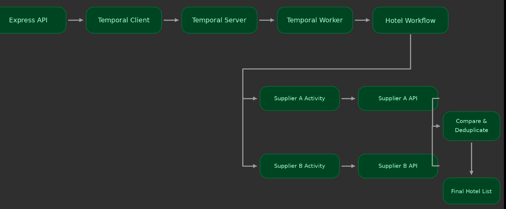

## Temporal:
- Imagine we have a request from : ``` GET /api/hotels?city=delhi.```

### Our application needs to perform these operations:
1. Fetch hotels from Supplier A.
2. Fetch hotels from Supplier B.
3. Wait until both responses arrive.
4. Compare hotels with matching names.
5. Select the cheaper offer.
6. Return the final list.

So temporal acts a manaing coordinator from various processes and return the final result.

### Various Temporal terms:

| Concept | Simple Meaning | Our Project |
| :--- | :--- | :--- |
| **Workflow** | Defines the overall process | Fetch, compare, and return hotels |
| **Activity** | Performs an individual task | Fetch Supplier A's hotels |
| **Worker** | Executes workflows and activities | Runs our hotel workflow |
| **Client** | Starts workflow executions | Express API starts a workflow |

### Working of Temporal:


### Activity:
In ```src/activities/hotel.activity.ts``` -

 - ```getSupplierAHotels("Delhi")``` makes the req. to Supplier A API(given).


### Workflow Codeblock:
our ```src/workflows/hotel.workflow.ts``` executes in the 6 stp process as said in the starting.

### MI* Logic:
Since, we need to compare the prices of both the request from API- A, B. Thus, we need to wait till both the requests are not fulfilled.

```
const [hotelsA, hotelsB] = await Promise.all([
    getSupplierAHotels(city),
    getSupplierBHotels(city)
]);
```

We're using hashmap to store and compare the prices of same location as :
```
if (!existing || hotel.price < existing.price){
    bestOffers.set(key, {
                name: hotel.name,
                price: hotel.price,
                supplier,
                commissionPct: hotel.commissionPct
            });
}
```

## Redis:
### Cache Memeory for faster responses.

- Various Redis Syntaxes:


| Redis Operation | Purpose |
| :--- | :--- |
| `DEL` | Remove old offers for a city |
| `ZADD` | Store hotel JSON with price as score |
| `ZRANGEBYSCORE` | Retrieve hotels within a price range |

